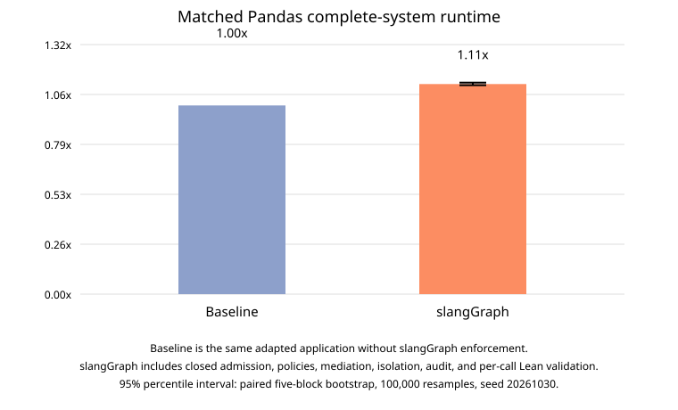

# Matched Pandas complete-system overhead

## Primary result

| Condition | Internal configuration | Attempts | Success | Timeouts | Mean complete-system wall time |
|---|---|---:|---:|---:|---:|
| Baseline | `Baseline` | 50 | 50/50 | 0/50 | 10228.4 ms |
| slangGraph | `C-full-lean` | 50 | 50/50 | 0/50 | 11388.9 ms |

Across the complete set of 100 attempted task trials, slangGraph is **1.113x** the Baseline runtime, or **11.3% overhead**. The paired-block 95% interval is **[1.107x, 1.121x]**, corresponding to **[10.7%, 12.1%]** overhead.

The interval is a percentile bootstrap of the ratio of means with 100,000 resamples and seed `20261030`. Each resampling unit is one paired repetition block containing all ten tasks in both conditions. With only five blocks, precision is limited; the 100 task trials are not treated as independent repetitions.

Timeouts use a 180,000 ms cap in the primary estimand. The table reports timeout counts explicitly; capped durations are retained rather than discarded.

## Correctness and matched-success sensitivity

Baseline succeeded on 50/50 attempts; Argus succeeded on 50/50. Every protected attempt completed successfully and matched the trusted utility oracle. The secondary matched-success analysis contains 50 task/repetition pairs, with means 10228.4 ms and 11388.9 ms and ratio 1.113x.

| Task | Baseline success | Argus success | Baseline mean | Argus mean | Ratio |
|---|---:|---:|---:|---:|---:|
| `date_filtered_total` | 5/5 | 5/5 | 10214.3 ms | 11246.3 ms | 1.101x |
| `duplicate_count` | 5/5 | 5/5 | 9282.1 ms | 10425.1 ms | 1.123x |
| `grouped_mean` | 5/5 | 5/5 | 19141.9 ms | 20514.2 ms | 1.072x |
| `missing_count` | 5/5 | 5/5 | 6166.3 ms | 7179.3 ms | 1.164x |
| `monthly_chart` | 5/5 | 5/5 | 15484.4 ms | 16877.3 ms | 1.090x |
| `monthly_mean` | 5/5 | 5/5 | 10595.2 ms | 11977.9 ms | 1.131x |
| `monthly_total` | 5/5 | 5/5 | 11335.9 ms | 12509.3 ms | 1.104x |
| `product_totals` | 5/5 | 5/5 | 7599.3 ms | 8461.5 ms | 1.113x |
| `regional_totals` | 5/5 | 5/5 | 5866.7 ms | 6928.2 ms | 1.181x |
| `top_products` | 5/5 | 5/5 | 6597.4 ms | 7770.2 ms | 1.178x |

## Measurement boundary

Both conditions use the same subprocess wall-clock boundary: interpreter startup, application preparation, model callbacks, retries, computation, conversions, and output production. Common campaign preparation and shared model warmup are excluded symmetrically and recorded in `raw/setup.json`. Argus selects closed admission, principal and sealed operator policies, dataset/resource mediation, Linux isolation, security audit, output mediation, preflight-only integrity checking, and the pinned inline native lifecycle checker. Baseline uses direct dataset loading and the application's vendor sandbox subprocess with no Argus authorization, activation, broker, audit, or runtime validator.

