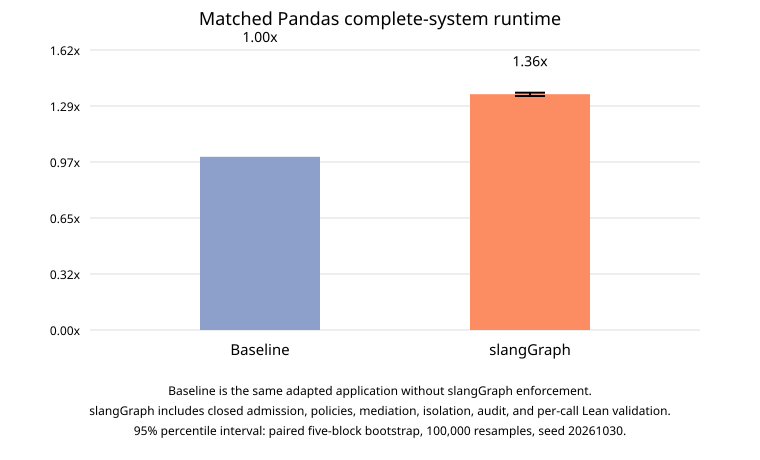

# Matched Pandas complete-system overhead

## Primary result

| Condition | Internal configuration | Attempts | Success | Timeouts | Mean complete-system wall time |
|---|---|---:|---:|---:|---:|
| Baseline | `Baseline` | 50 | 50/50 | 0/50 | 10249.9 ms |
| slangGraph | `C-full-lean` | 50 | 45/50 | 0/50 | 13951.4 ms |

Across the complete set of 100 attempted task trials, slangGraph is **1.361x** the Baseline runtime, or **36.1% overhead**. The paired-block 95% interval is **[1.351x, 1.370x]**, corresponding to **[35.1%, 37.0%]** overhead.

The interval is a percentile bootstrap of the ratio of means with 100,000 resamples and seed `20261030`. Each resampling unit is one paired repetition block containing all ten tasks in both conditions. With only five blocks, precision is limited; the 100 task trials are not treated as independent repetitions.

Timeouts use a 180,000 ms cap in the primary estimand. The table reports timeout counts explicitly; capped durations are retained rather than discarded.

## Correctness and matched-success sensitivity

Baseline succeeded on 50/50 attempts; slangGraph succeeded on 45/50. Baseline completed all five `monthly_mean` trials, while slangGraph refused all five at the preserved non-finite output-validation boundary. The primary comparison retains every attempt, including those five protected failures. The secondary matched-success analysis contains 45 task/repetition pairs, with means 10214.9 ms and 14010.4 ms and ratio 1.372x. It is supporting analysis, not a replacement for the primary result.

## Measurement boundary

Both bars use the same subprocess wall-clock boundary: interpreter startup, application preparation, model callbacks, retries, computation, conversions, and output production. Common campaign preparation and the shared model warmup are excluded symmetrically and recorded in `raw/setup.json`. slangGraph additionally includes closed admission, principal and sealed operator policies, dataset/resource mediation, Linux isolation, security audit, output mediation, and per-call Lean runtime validation. Baseline uses direct dataset loading and the application's vendor sandbox subprocess with no slangGraph authorization, activation, broker, audit, or runtime validator.

