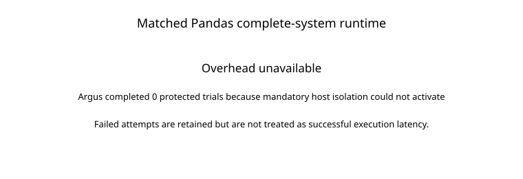

# Matched Pandas complete-system overhead

## Primary result

| Condition | Internal configuration | Attempts | Success | Timeouts | Mean complete-system wall time |
|---|---|---:|---:|---:|---:|
| Baseline | `Baseline` | 50 | 50/50 | 0/50 | 10328.0 ms |
| slangGraph | `C-full-lean` | 50 | 0/50 | 0/50 | 9337.4 ms |

A complete-system overhead ratio is **unavailable**: Argus completed 0/50 protected trials because mandatory bubblewrap isolation could not activate on this host. The mean duration of failed protected attempts was 9337.4 ms, but the resulting 0.904x failed-attempt-duration ratio is **not execution overhead** and is not plotted as one.

Timeouts use a 180,000 ms cap in the primary estimand. The table reports timeout counts explicitly; capped durations are retained rather than discarded.

## Correctness and matched-success sensitivity

Baseline succeeded on 50/50 attempts; Argus succeeded on 0/50. All protected attempts failed at host activation before computation because mandatory bubblewrap isolation was unavailable. No matched-success timing analysis is available because no protected trial completed.

## Measurement boundary

Both conditions use the same subprocess wall-clock boundary: interpreter startup, application preparation, model callbacks, retries, computation, conversions, and output production. Common campaign preparation and shared model warmup are excluded symmetrically and recorded in `raw/setup.json`. Argus selects closed admission, principal and sealed operator policies, dataset/resource mediation, Linux isolation, security audit, output mediation, preflight-only integrity checking, and the pinned inline native lifecycle checker. Baseline uses direct dataset loading and the application's vendor sandbox subprocess with no Argus authorization, activation, broker, audit, or runtime validator.

